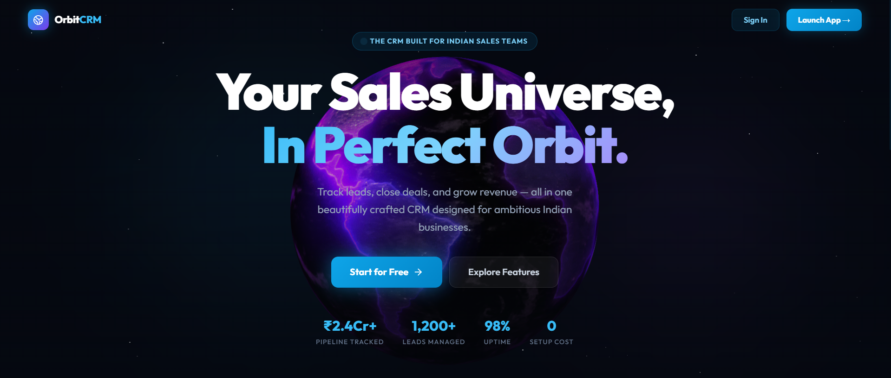
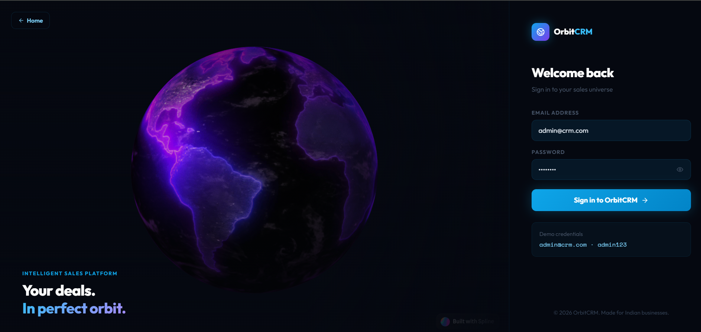
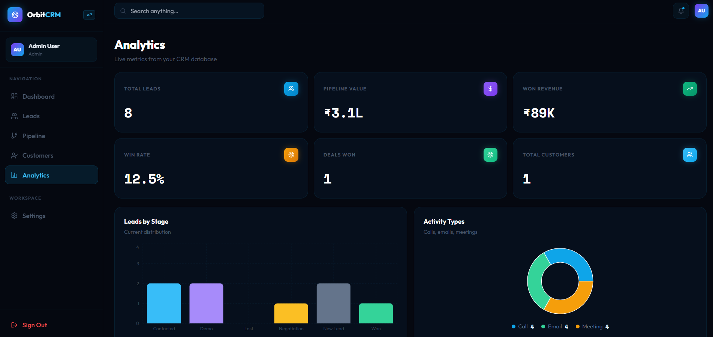

** <div align="center">


# 🪐 OrbitCRM

### *Your Sales Universe, In Perfect Orbit.*

**A full-stack CRM built for ambitious Indian businesses — track leads, close deals, grow revenue.**

[](https://crm-bay-nu.vercel.app/)
[](https://github.com/pranithamalasala/crm)
[]()
[]()

</div>

---

## 📸 Preview

| Landing Page | Login | Analytics Dashboard |
|:---:|:---:|:---:|
|  |  |  |

> **Demo credentials:** `admin@crm.com` / `admin123`

---

## ✨ Features

| Module | What it does |
|---|---|
| 🔐 **Auth** | Secure login with persistent session via `sessionStorage` |
| 📊 **Analytics** | Live KPI dashboard — pipeline value, win rate, revenue, charts |
| 👥 **Leads** | Full CRUD, filtering, sorting, CSV export |
| 🗂 **Pipeline** | Kanban board with drag-and-drop stage transitions |
| 👤 **Customers** | Customer profiles with activity timeline |
| 📝 **Activities** | Log calls, emails, meetings with timestamps |
| 📱 **UI** | Fully responsive dark-theme interface |
| 🐳 **Docker** | Containerized frontend and backend using Docker Compose |

---

## 🚀 Quick Start

### Prerequisites

- **Python 3.8+**
- **Node.js 18+**
- **Docker Desktop** (optional, for containerized setup)

### 1. Clone the repository

```bash
git clone https://github.com/pranithamalasala/crm.git
cd crm
```

### 2. Run with Docker

```bash
docker compose up --build -d
```

Open the frontend at **http://localhost:5173**.

The Flask backend runs at **http://localhost:10000**.

To stop the containers:

```bash
docker compose down
```

### 3. Run manually

#### Start the backend

```bash
cd backend
pip install -r requirements.txt
python run.py
```

#### Start the frontend

Open another terminal:

```bash
cd frontend
npm install
npm run dev
```

Open **http://localhost:5173**.

> The backend port depends on your environment configuration. The Docker setup uses port `10000`.

### 4. Login

| Email | Password |
|---|---|
| `admin@crm.com` | `admin123` |

---

## 🏗 Tech Stack

### Frontend

- **React 18** + **Vite** — modern frontend tooling
- **Tailwind CSS** — utility-first styling
- **React Router v6** — client-side routing
- **Recharts** — data visualizations
- **Lucide React** — icon system

### Backend

- **Flask 3** — Python web framework
- **flask-cors** — cross-origin resource sharing
- **bcrypt** — password hashing
- **python-dotenv** — environment configuration

### Database

- **SQLite** — file-based database (`crm.db`)

### DevOps

- **Docker** — containerization
- **Docker Compose** — multi-container orchestration
- **Vercel** — frontend deployment

---

## 🔌 API Reference

| Method | Endpoint | Description |
|---|---|---|
| `POST` | `/users/login` | Authenticate user |
| `GET` | `/leads` | Fetch all leads |
| `POST` | `/leads` | Create a new lead |
| `PUT` | `/leads/:id` | Update a lead |
| `DELETE` | `/leads/:id` | Delete a lead |
| `GET` | `/pipeline/board` | Get pipeline board view |
| `POST` | `/pipeline/move` | Move lead between stages |
| `GET` | `/customers` | Fetch all customers |
| `PUT` | `/customers/:id` | Update a customer |
| `DELETE` | `/customers/:id` | Delete a customer |
| `GET` | `/activities` | Fetch activity logs |
| `POST` | `/activities` | Log a new activity |
| `GET` | `/analytics` | Dashboard analytics data |

---

## 📁 Project Structure

```text
crm/
├── backend/
│   ├── app/
│   │   ├── routes/
│   │   └── models/
│   ├── migrations/
│   ├── Dockerfile
│   ├── .dockerignore
│   ├── requirements.txt
│   └── run.py
├── frontend/
│   ├── src/
│   │   ├── components/
│   │   ├── pages/
│   │   └── api/
│   ├── Dockerfile
│   ├── .dockerignore
│   └── package.json
├── docker-compose.yml
├── screenshots/
└── README.md
```

---

## 👥 Contributors

<table>
  <tr>
    <td align="center">
      <a href="https://github.com/pranithamalasala">
        <b>Pranitha</b><br/>
        <sub>Frontend & Integration</sub>
      </a>
    </td>
    <td align="center">
      <a href="https://github.com/sushantbhatt17">
        <b>Sushant Bhatt</b><br/>
        <sub>Backend & Database</sub>
      </a>
    </td>
  </tr>
</table>

---

## 🗺 Roadmap

- [ ] JWT-based authentication
- [ ] Role-based access control (Admin / Sales Rep)
- [ ] Email notifications and reminders
- [ ] Real-time activity updates
- [ ] Persistent cloud database
- [ ] Cloud deployment guide (Docker / AWS)
- [ ] Mobile app (React Native)

---

## 🤝 Contributing

Pull requests are welcome! For major changes, please open an issue first to discuss what you'd like to change.

```bash
git checkout -b feature/your-feature-name
git commit -m "feat: add your feature"
git push origin feature/your-feature-name
```

---

## 📄 License

This project is open-source and available under the [MIT License](LICENSE).

---

<div align="center">

**Built with ❤️ for Indian Sales Teams**

⭐ Star this repo if you found it useful!

[](https://github.com/pranithamalasala/crm)

</div>
**
